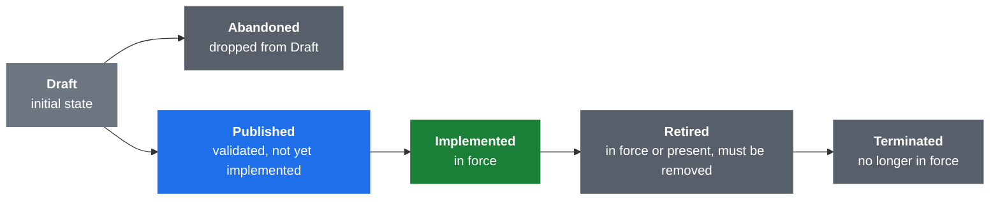
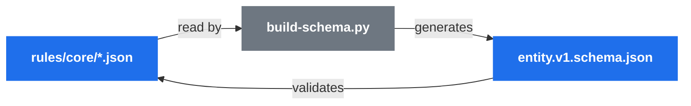
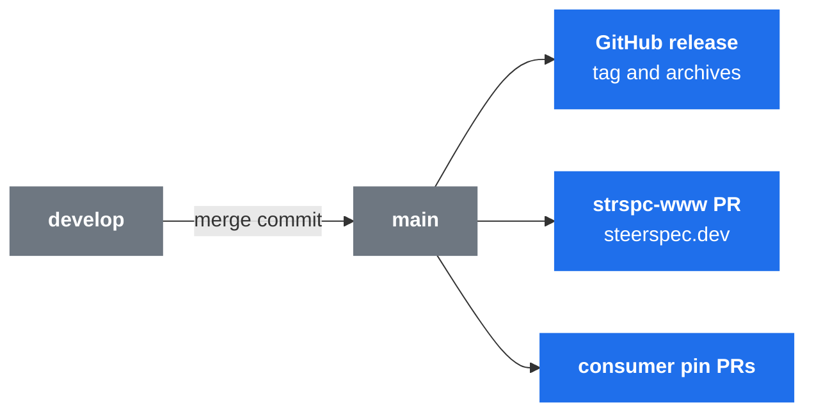

<div align="center">


# SteerSpec Core Rules

**The canonical rule format of the SteerSpec ecosystem, written in the format it defines.**

[](https://github.com/SteerSpec/strspc-rules/actions/workflows/ci.yml)
[](https://github.com/SteerSpec/strspc-rules/releases)
[](LICENSE)

[Rules](#the-rules) · [Lifecycle](#rule-lifecycle) · [Schemas](#schema-system) · [Realms](#realms) ·
[Development](#development) · [CI](#ci) · [Releases](#releases) · [Published files](#published-at-steerspecdev)

</div>

This repository holds the `dev.steerspec.core` realm: the foundational rule definitions that govern how
every [SteerSpec](https://steerspec.dev) specification is structured, versioned and interpreted.

## The rules

**JSON is the source of truth.** There is no Markdown in `rules/core/`; the
[`strspc` CLI](https://github.com/SteerSpec/strspc-CLI) renders it as a view.

| Entity | Covers |
| ------ | ------ |
| [`ENT`](rules/core/ENT.json) | Entities |
| [`KWRD`](rules/core/KWRD.json) | Keywords derived from RFC 2119: MUST, SHOULD, MAY, … |
| [`NTE`](rules/core/NTE.json) | Notes |
| [`RLIFRMT`](rules/core/RLIFRMT.json) | The rule identifier format |
| [`RLM`](rules/core/RLM.json) | Realms: namespace definition, cross-realm references |
| [`RST`](rules/core/RST.json) | Rule sets |
| [`RUL`](rules/core/RUL.json) | Rules and rule states |
| [`SPCFG`](rules/core/SPCFG.json) | SteerSpec configuration: a consumer's `.strspc/` directory |

```text
rules/core/
├── realm.json                     Realm manifest (namespace metadata, not an entity)
├── <ENTITY>.json                  The entities above
└── _schema/
    ├── bootstrap.schema.json      Minimal schema for CI validation (hand-maintained axiom)
    ├── config.v1.schema.json      Config schema (generated from the SPCFG rules)
    ├── entity.v1.schema.json      Full entity schema (generated by build-schema.py)
    └── realm.v1.schema.json       Realm manifest schema (hand-maintained axiom)

tools/
├── build-manifest.py              Generates the index.json manifest for published rules
├── build-schema.py                Generates entity.v1 and config.v1 from the rules themselves
├── compute-hash.py                Computes Blake3 content hashes for rule-set integrity
├── hash_util.py                   Shared Blake3 canonicalization and hashing utilities
├── pin_core.py                    Rewrites the core pins in consumer repositories
└── tests/                         Unit tests
```

## Rule lifecycle

A rule moves forward only, and takes each state at most once. [`RUL.json`](rules/core/RUL.json) defines the states.



Rule text is immutable once a rule leaves Draft. CI fails only on Implemented rules (`fail_on: [I]`).

## Schema system

The schema is **self-recursive**: `tools/build-schema.py` reads the rules to generate
`entity.v1.schema.json`, which then validates those same rule files.



A minimal `bootstrap.schema.json` is checked in, so CI can validate without running the generator.

## Realms

A **Realm** is a namespace in which Entity Unique Identifiers (EUIDs) are unique. Each Realm is a directory
holding entity JSON files, a `_schema/` directory and a `realm.json` manifest that declares the Realm's identity,
version and dependencies.

- Realm IDs use **reverse domain notation** (e.g. `dev.steerspec.core`) for global uniqueness.
- Cross-realm entity references use the qualified form `<realm-id>:<EUID>`.
- The core Realm (`dev.steerspec.core`) defines the foundational rules in this repository.

[`RLM.json`](rules/core/RLM.json) formalizes these rules, and `realm.v1.schema.json`, a hand-maintained axiom,
validates the manifest format.

The schema requires `realm.version` to be `MAJOR.MINOR.PATCH` (it becomes the release tag) and
`dependencies[].version` to be a SemVer version, so ranges and values like `latest` are rejected.

## Development

Prerequisites: Python 3.12+ and [pre-commit](https://pre-commit.com/).

```bash
pip install -r requirements.txt
pip install pre-commit
pre-commit install
pre-commit install --hook-type commit-msg
```

Hooks run on each commit:

| Hook | Checks |
| ---- | ------ |
| actionlint | GitHub Actions workflow syntax |
| yamllint | YAML formatting |
| markdownlint | Markdown style |
| editorconfig-checker | EditorConfig compliance |
| ruff | Python lint (pycodestyle, pyflakes, isort, bugbear, …) |
| ruff-format | Python formatting |
| commitlint | Conventional Commits message format |

To run the validation by hand:

```bash
python3 tools/build-schema.py --check                  # JSON schema
ruff check . && ruff format --check .                  # Python lint and format
python3 -m unittest discover -s tools/tests -t tools   # Unit tests
```

## CI

Every pull request runs these jobs from [`ci.yml`](.github/workflows/ci.yml):

| Job | Description |
| --- | ----------- |
| `rules` | Org `strspc-lint` workflow: realm validate, lint, lifecycle diff against the base |
| `check` | Org `strspc-check` workflow, static only: resolves the realm, verifying cross-realm references |
| `lint-commits` | Conventional Commits enforcement (pull requests only) |
| `lint-python` | Ruff lint and format check, unit tests |
| `lint` | actionlint, yamllint, markdownlint, editorconfig-checker |

[`build-schema.yml`](.github/workflows/build-schema.yml) also runs `python3 tools/build-schema.py --check`
whenever the rules, the schemas or the generator change.

Release pull requests (`develop` → `main`) skip the `strspc diff` lifecycle check: they aggregate transitions that
were validated one pull request at a time on the way into `develop`.

## Releases

Releases follow [semantic versioning](https://semver.org/) and are tagged `v<MAJOR>.<MINOR>.<PATCH>`.

**The realm version is the release tag.** Merging `develop` into `main` tags `realm.version` from
[`rules/core/realm.json`](rules/core/realm.json), and dependent realms pin it as `dev.steerspec.core@<version>`.
If the tag already exists on another commit the release is skipped, so bump `realm.version` in the pull request that
should trigger a release. If it exists on the same commit, the run resumes the release.



Each release includes:

- The full `rules/` directory, with the `LICENSE` and `NOTICE` files
- Archives: `strspc-rules-<version>.tar.gz` and `strspc-rules-<version>.zip`
- A publish PR on strspc-www (schemas, rules, manifest), which deploys to steerspec.dev once merged
- Pin PRs (`chore(rules): pin dev.steerspec.core to X.Y.Z`) in strspc-manager, strspc-CLI, strspc-sync,
  strspc-spec, strspc-pr-review and strspc-cloud, opened by
  [`pin-consumers.yml`](.github/workflows/pin-consumers.yml); each PR also syncs the
  consumer's `rules/_schema/`

## Published at steerspec.dev

Each release's schemas and rules are served from [steerspec.dev](https://steerspec.dev) (GitHub Pages), which makes
the schema `$id` URLs resolvable and gives the CLI and other tools stable endpoints.

| URL | Description |
| --- | ----------- |
| `https://steerspec.dev/schemas/entity/v1.json` | Full entity schema (matches `$id`) |
| `https://steerspec.dev/schemas/entity/bootstrap.json` | Bootstrap schema (matches `$id`) |
| `https://steerspec.dev/schemas/realm/v1.json` | Realm manifest schema (matches `$id`) |
| `https://steerspec.dev/schemas/config/v1.json` | Config schema (matches `$id`) |
| `https://steerspec.dev/rules/latest/index.json` | Manifest with filenames, versions, blake3 hashes |
| `https://steerspec.dev/rules/latest/<ENTITY>.json` | Latest rule files |
| `https://steerspec.dev/rules/v<version>/` | Versioned snapshots |

The publish step is a job in [`release.yml`](.github/workflows/release.yml). It opens a pull request on
[strspc-www](https://github.com/SteerSpec/strspc-www) (`publish/rules-v<version>`), and merging that deploys the
files. The commit is signed when the SteerSpec GitHub App credentials (`STEERSPEC_APP_ID`,
`STEERSPEC_PRIVATE_KEY`) are configured.

### Referencing a specific version

Use steerspec.dev for stable, versioned access:

```text
https://steerspec.dev/rules/v1.11.0/RUL.json
```

Or download the archive for offline use:

```text
https://github.com/SteerSpec/strspc-rules/releases/download/v1.11.0/strspc-rules-1.11.0.tar.gz
```

## License

Apache 2.0, see [LICENSE](LICENSE) and [NOTICE](NOTICE).
