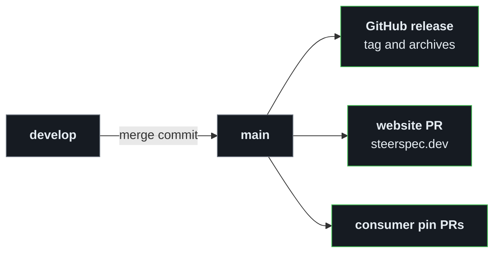

# Releases and published files

In this page `<version>` is a release number in the form `MAJOR.MINOR.PATCH`, without the leading `v`.

## Releases

Releases follow [semantic versioning](https://semver.org/) and are tagged `v<MAJOR>.<MINOR>.<PATCH>`.

**The realm version is the release tag.** Merging `develop` into `main` tags `realm.version` from
[`rules/core/realm.json`](../rules/core/realm.json), and dependent realms pin it as `dev.steerspec.core@<version>`.
If the tag already exists on another commit the release is skipped, so bump `realm.version` in the pull request that
should trigger a release. If it exists on the same commit, the run resumes the release.

Each release includes:

- The full `rules/` directory, with the `LICENSE` and `NOTICE` files
- Archives: `strspc-rules-<version>.tar.gz` and `strspc-rules-<version>.zip`
- A publish PR on the SteerSpec website repository (schemas, rules, manifest), which deploys to steerspec.dev once merged
- Pin PRs (`chore(rules): pin dev.steerspec.core to X.Y.Z`) in strspc-manager, strspc-CLI, strspc-sync,
  strspc-spec, strspc-pr-review and other SteerSpec consumer repositories, opened by
  [`pin-consumers.yml`](../.github/workflows/pin-consumers.yml); each PR also syncs the
  consumer's `rules/_schema/`

## Published at steerspec.dev

Each release's schemas and rules are served from [steerspec.dev](https://steerspec.dev) (GitHub Pages), which makes
the schema `$id` URLs resolvable and gives the CLI and other tools fixed URLs for each release.

| URL | Description |
| --- | ----------- |
| `https://steerspec.dev/schemas/entity/v1.json` | Full entity schema (matches `$id`) |
| `https://steerspec.dev/schemas/entity/bootstrap.json` | Bootstrap schema (matches `$id`) |
| `https://steerspec.dev/schemas/realm/v1.json` | Realm manifest schema (matches `$id`) |
| `https://steerspec.dev/schemas/config/v1.json` | Config schema (matches `$id`) |
| `https://steerspec.dev/rules/latest/index.json` | Manifest with filenames, versions, blake3 hashes |
| `https://steerspec.dev/rules/latest/<ENTITY>.json` | Latest rule files |
| `https://steerspec.dev/rules/v<version>/` | Versioned snapshots |

The publish step is a job in [`release.yml`](../.github/workflows/release.yml). It opens a pull request on the
SteerSpec website repository (`publish/rules-v<version>`), and merging that deploys the files. The commit is
signed when the SteerSpec GitHub App is configured.
