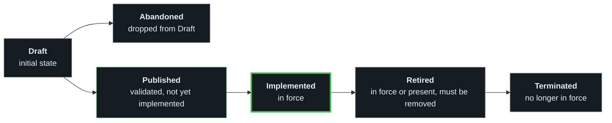

# Rules and lifecycle

## The rules

**JSON is the source of truth.** There is no Markdown in `rules/core/`; the
[`strspc` CLI](https://github.com/SteerSpec/strspc-CLI) renders it as a view.

| Entity | Covers |
| ------ | ------ |
| [`CTRB`](../rules/core/CTRB.json) | Contributors: who adds rules and notes |
| [`ENT`](../rules/core/ENT.json) | Entities |
| [`KWRD`](../rules/core/KWRD.json) | Keywords derived from RFC 2119: MUST, SHOULD, MAY, … |
| [`NTE`](../rules/core/NTE.json) | Notes |
| [`RLIFRMT`](../rules/core/RLIFRMT.json) | The rule identifier format |
| [`RLM`](../rules/core/RLM.json) | Realms: namespace definition, cross-realm references |
| [`RST`](../rules/core/RST.json) | Rule sets |
| [`RUL`](../rules/core/RUL.json) | Rules and rule states |
| [`SPCFG`](../rules/core/SPCFG.json) | SteerSpec configuration: a consumer's `.strspc/` directory |

```text
rules/core/
├── realm.json                     Realm manifest (namespace metadata, not an entity)
├── <ENTITY>.json                  The entities above
└── _schema/
    ├── bootstrap.schema.json      Minimal schema for CI validation (hand-maintained axiom)
    ├── config.v1.schema.json      Config schema (generated from the SPCFG rules)
    ├── entity.v1.schema.json      Full entity schema (generated by build-schema.py)
    └── realm.v1.schema.json       Realm manifest schema (hand-maintained axiom)

tools/
├── build-manifest.py              Generates the index.json manifest for published rules
├── build-schema.py                Generates entity.v1 and config.v1 from the rules themselves
├── compute-hash.py                Computes Blake3 content hashes for rule-set integrity
├── hash_util.py                   Shared Blake3 canonicalization and hashing utilities
├── pin_core.py                    Rewrites the core pins in consumer repositories
└── tests/                         Unit tests
```

## Rule lifecycle

A rule moves forward only, and takes each state at most once. [`RUL.json`](../rules/core/RUL.json) defines the states.



Rule text is immutable once a rule leaves Draft. CI fails only on Implemented rules (`fail_on: [I]`).
