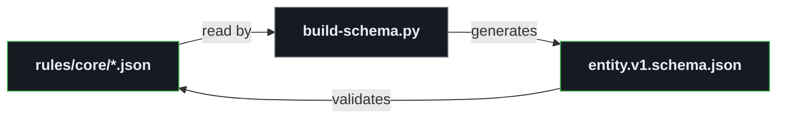

# Schemas and realms

## Schema system

The schema is **self-recursive**: `tools/build-schema.py` reads the rules to generate
`entity.v1.schema.json`, which then validates those same rule files.

A minimal `bootstrap.schema.json` is checked in, so CI can validate without running the generator.

## Realms

A **realm** is a namespace in which Entity Unique Identifiers (EUIDs) are unique. Each realm is a directory
holding entity JSON files, a `_schema/` directory and a `realm.json` manifest that declares the realm's identity,
version and dependencies.

- Realm IDs use **reverse domain notation** (e.g. `dev.steerspec.core`) for global uniqueness.
- Cross-realm entity references use the qualified form `<realm-id>:<EUID>`.
- The core realm (`dev.steerspec.core`) defines the foundational rules in this repository.

[`RLM.json`](../rules/core/RLM.json) formalizes these rules, and `realm.v1.schema.json`, a hand-maintained axiom,
validates the manifest format.

The schema requires `realm.version` to be `MAJOR.MINOR.PATCH` (it becomes the release tag) and
`dependencies[].version` to be a SemVer version, so ranges and values like `latest` are rejected.
